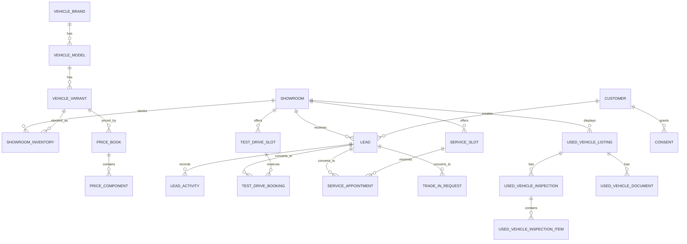

# Database architecture

## 1. Current state

The foundation includes one domain table and one committed Prisma migration:

| Object               | Purpose                                                                                   |
| -------------------- | ----------------------------------------------------------------------------------------- |
| `showrooms`          | Physical dealership location and the anchor for future inventory, appointments, and staff |
| `_prisma_migrations` | Prisma migration bookkeeping (managed by Prisma)                                          |

Migration: `apps/api/prisma/migrations/20261106050109_init/migration.sql`

```prisma
model Showroom {
  id        String   @id @default(cuid())
  code      String   @unique
  name      String
  city      String   @default("Lucknow")
  state     String   @default("Uttar Pradesh")
  timezone  String   @default("Asia/Kolkata")
  isActive  Boolean  @default(true)
  createdAt DateTime @default(now())
  updatedAt DateTime @updatedAt

  @@index([city, isActive])
  @@map("showrooms")
}
```

No inventory, pricing, customer, staff, booking, or content rows exist. The service does not insert
fake records. The health check performs `SELECT 1`; it does not depend on seed data.

## 2. Database conventions

These conventions apply to every table added after the foundation:

- **Primary keys:** `cuid()` strings by default. Use a natural unique key only where it is genuinely
  stable and globally unique.
- **Timestamps:** `createdAt` and `updatedAt` in UTC. Business-day calculations use the showroom's
  IANA timezone (`Asia/Kolkata`).
- **Money:** integer paise (`BigInt` for aggregates where needed), never floating point. Display
  formatting belongs in the shared package.
- **Currency:** INR. Do not store a currency column unless multi-currency becomes a real
  requirement.
- **Soft deletion:** use `deletedAt` on business entities that need recovery or retention. Audit and
  consent records are append-only and must not be deleted in normal operation.
- **Human-readable codes:** stable, uppercase codes for showrooms, price components, statuses, and
  import batches.
- **Enums:** prefer database enums or constrained lookup tables for workflow states. Keep the
  transition rules in the API, not only in the UI.
- **PII:** store only what the service needs. Normalise phone numbers to E.164. Do not store
  Aadhaar, PAN, full payment credentials, or unrestricted document images without a specific,
  reviewed requirement.
- **Indexes:** every foreign key gets an index unless a covering composite index already starts with
  it. List and filter paths get explicit composite indexes.
- **Cascades:** avoid cascading deletion of customer, lead, booking, inspection, consent, and audit
  history. Prefer restrictive foreign keys or soft deletion.
- **Transactions:** capacity checks, price publication, assignment, and conversion workflows run
  inside transactions with explicit locking where required.
- **Idempotency:** customer-facing mutations accept an idempotency key stored with a unique
  constraint, so retries cannot create duplicate bookings or leads.
- **Migration safety:** additive first, backfill, switch reads/writes, then remove in a later
  release. Never edit an applied migration.

## 3. Planned domain model

The following is the target model, not an implemented schema. Table names are proposals.

### 3.1 Locations and staff

```text
showrooms (implemented)
  ├── <staff assignments>
  ├── <inventory>
  ├── <test-drive slots>
  ├── <service bays / slots>
  └── <leads and appointments>

staff_users
  id, email, phone, password_hash / identity_provider_id,
  display_name, role, is_active, last_login_at

staff_showroom_assignments
  id, staff_user_id, showroom_id, is_primary

audit_logs
  id, actor_staff_id?, action, entity_type, entity_id,
  before_json?, after_json?, request_id, ip_hash?, created_at
```

Roles to support: dealership administrator, sales consultant, used-car desk, service advisor.
Authorization is enforced in the API; the database stores role assignments and audit records.

### 3.2 Customers, consent, and leads

```text
customers
  id, full_name, phone_e164, email?, preferred_showroom_id?,
  created_at, updated_at, anonymised_at?

consents
  id, customer_id, purpose, lawful_basis, granted,
  notice_version, granted_at, withdrawn_at?, source, ip_hash?
  -- append-only; do not overwrite history

leads
  id, reference_code, customer_id, showroom_id,
  type, source, status, interest_summary,
  assigned_staff_id?, assigned_at?, response_due_at?,
  first_responded_at?, closed_at?, lost_reason?,
  created_at, updated_at

lead_activities
  id, lead_id, staff_user_id?, type, body?,
  occurred_at, created_at

lead_assignments
  id, lead_id, staff_user_id, assigned_by_id?,
  assigned_at, unassigned_at?
```

Lead types include new-car enquiry, certified pre-owned enquiry, test drive, service, trade-in,
finance, and general contact. Sources include website, phone, walk-in, referral, and CSV import.

CSV import should use two tables:

```text
lead_import_batches
  id, file_name, uploaded_by_id, status,
  total_rows, accepted_rows, rejected_rows, created_at, completed_at?

lead_import_rows
  id, batch_id, row_number, raw_data_json, normalised_data_json?,
  status, error_code?, error_detail?, lead_id?
  -- unique (batch_id, row_number)
```

A checksum of the file plus explicit operator confirmation prevents duplicate imports. Imported
leads retain their source and original row reference for traceability.

### 3.3 Catalogue and new-vehicle inventory

```text
vehicle_brands
  id, name, slug, is_active

vehicle_models
  id, brand_id, name, slug, body_type, is_active

vehicle_variants
  id, model_id, name, fuel_type, transmission,
  seating_capacity, is_active

vehicle_colours
  id, name, hex_code?, is_active

showroom_inventory
  id, showroom_id, variant_id, colour_id,
  vin?, stock_status, is_demo, is_active,
  received_at?, created_at, updated_at

media_assets
  id, entity_type, entity_id, storage_key, alt_text,
  mime_type, width, height, sort_order, created_at
```

`vin` should be unique when present. Stock statuses might include `IN_TRANSIT`, `AVAILABLE`,
`RESERVED`, `SOLD`, `DEMO`, and `WITHDRAWN`. The "car you book is the car you drive" requirement
means reservations must reference concrete inventory, not only a variant.

### 3.4 On-road pricing

The pricing model is versioned. A price is not edited in place after publication; a new version is
created and the old one is retired.

```text
price_books
  id, showroom_id, variant_id, effective_from, effective_to?,
  status, published_by_id?, published_at?, created_at

price_components
  id, price_book_id, component_type, label,
  amount_paise, is_mandatory, is_tax_inclusive, sort_order
  -- component_type: EX_SHOWROOM, RTO_TAX, REGISTRATION,
  -- INSURANCE, ACCESSORIES, EXTENDED_WARRANTY, OTHER
```

Rules:

- At most one `PUBLISHED` price book may be active for a showroom + variant at a point in time.
- Components are additive and sum to the displayed on-road price.
- The API calculates the total from components; it does not store a single opaque on-road price that
  can disagree with the breakdown.
- Every component is displayed separately with its label. Optional components are marked optional.
- RTO/registration and insurance values can differ by showroom and must not be hard-coded globally.
- Price changes after a lead or booking are versioned. Historical quotes reference the price book
  used.
- Admin price tables require audit records for publish, retire, and correction actions.
- All amounts are integer paise.

A future `quotes` table should reference the price book and capture a snapshot for an individual
customer. It must not depend on the current price row continuing to exist unchanged.

### 3.5 Certified pre-owned vehicles

```text
used_vehicle_listings
  id, reference_code, showroom_id, make, model, variant,
  registration_year, registration_state, fuel_type, transmission,
  ownership_count, odometer_km, colour, asking_price_paise,
  status, published_at?, sold_at?, created_at, updated_at

used_vehicle_inspections
  id, listing_id, version, inspected_by_id?, inspected_at,
  overall_result, summary, created_at

used_vehicle_inspection_items
  id, inspection_id, category, label, result, notes?,
  estimated_repair_paise?, sort_order

used_vehicle_documents
  id, listing_id, document_type, storage_key, verified_at?, verified_by_id?

used_vehicle_price_components
  id, listing_id, component_type, label, amount_paise, sort_order
```

Requirements from the brief:

- Every listing has a published inspection report with photographs of the actual car.
- Ownership, service, and insurance history are visible in one file.
- Filters include make, model, year, price, fuel, transmission, kilometrage, and showroom.
- Inspection versions are immutable once published; corrections create a new version.
- Documents are private by default. Public listing pages expose only reviewed derivatives, never raw
  registration documents or personal data.
- A used vehicle can have multiple listings over time, but only one active listing at a time.

### 3.6 Test drives

```text
test_drive_slots
  id, showroom_id, inventory_id?, variant_id?,
  starts_at, ends_at, capacity, is_active
  -- unique (showroom_id, starts_at, inventory_id)

test_drive_bookings
  id, reference_code, slot_id, customer_id, lead_id?,
  status, idempotency_key, notes?, created_at, updated_at
  -- unique (idempotency_key)
```

Capacity is enforced in one transaction:

1. Lock the slot row (`SELECT ... FOR UPDATE`) or use an atomic counter with a guarded update.
2. Count confirmed, non-cancelled bookings.
3. Reject with `409 SLOT_FULL` when capacity is reached.
4. Insert the booking and link it to the lead.

This prevents two concurrent requests from both seeing one free place. Do not implement capacity as
a read-then-write check outside a transaction.

### 3.7 Workshop and service capacity

```text
service_offerings
  id, code, name, description, duration_minutes, is_active

service_bays
  id, showroom_id, name, is_active

service_advisors
  id, showroom_id, staff_user_id, is_active

service_slots
  id, showroom_id, starts_at, ends_at, capacity, is_active

service_appointments
  id, reference_code, slot_id, customer_id, lead_id?,
  vehicle_registration?, vehicle_description?, service_offering_id?,
  status, idempotency_key, advisor_id?, notes?,
  created_at, updated_at
```

The same transactional capacity rule as test drives applies. The slot capacity represents actual bay
and advisor availability. Workshop closures or exceptional capacity are explicit rows, not hidden
client-side rules. A confirmed appointment must never depend on a later manual check.

### 3.8 Trade-in and finance

```text
trade_in_requests
  id, reference_code, customer_id, showroom_id, lead_id?,
  make, model, variant, registration_year, odometer_km,
  fuel_type, transmission, ownership_count, condition_notes,
  status, offered_amount_paise?, appraised_by_id?, appraised_at?,
  created_at, updated_at

finance_enquiries
  id, reference_code, customer_id, lead_id?, showroom_id,
  vehicle_variant_id?, loan_amount_paise?, tenure_months?,
  employment_type?, status, created_at, updated_at
```

The brief's "email calculator" is interpreted as an **EMI calculator** (see
[`assumptions.md`](assumptions.md)). The calculator can be stateless:

```text
EMI = P × r × (1 + r)^n / ((1 + r)^n − 1)
```

where `P` is principal, `r` is the monthly interest rate, and `n` is the tenure in months. The API
should return the monthly EMI, total interest, and total payable, with the assumed rate clearly
labelled. A zero-interest case must be handled separately. Persist only an enquiry when the customer
asks to be contacted; do not store every exploratory calculation.

### 3.9 CMS and site content

```text
cms_pages
  id, slug, title, status, published_at?, updated_by_id?,
  created_at, updated_at

cms_sections
  id, page_id, section_type, sort_order, content_json, is_visible

cms_revisions
  id, page_id, revision_number, snapshot_json, created_by_id, created_at
```

Publishing is explicit and auditable. Draft content must not appear on the public route. Media
assets are referenced by ID rather than by embedding arbitrary HTML. Rich text must be sanitised.

### 3.10 AI assistance

```text
ai_summaries
  id, entity_type, entity_id, model_name, prompt_version,
  input_reference, output_text, status,
  reviewed_by_id?, reviewed_at?, created_at
```

AI output is a draft. Store enough provenance to reproduce and review it, but avoid retaining
unnecessary raw PII. A human must approve any output used in a customer interaction. AI must not
make final pricing, credit, insurance, or safety decisions.

### 3.11 Notifications and audit

```text
notifications
  id, recipient_staff_id?, recipient_customer_id?, channel,
  template_code, payload_json, status, scheduled_at?,
  sent_at?, failed_at?, error_code?

audit_logs
  id, actor_staff_id?, actor_type, action, entity_type, entity_id,
  before_json?, after_json?, request_id, created_at
```

Audit logs are append-only. Do not log secrets, full payment data, or unrestricted PII. Retention
must be defined with legal and business input.

## 4. Entity relationship sketch

This sketch shows the main future relationships. `Showroom` is the only implemented entity.



## 5. Non-functional data requirements

### Privacy and consent

- Consent is purpose-specific and append-only.
- A withdrawal records a new event; it does not erase the fact that consent was previously given.
- Customer records can be anonymised while retaining legally required transaction and audit records.
- Public pages never expose phone numbers, email addresses, registration documents, or internal
  notes.
- CSV imports must not bypass consent requirements. The import process records the source and
  lawful basis.

### Security

- Database access is least privilege and network-restricted.
- PII is encrypted in transit and at rest. Application-level field encryption may be required for
  sensitive documents.
- Application logs must redact phone numbers, emails, free-text notes, and document URLs.
- Backups inherit the same access controls as the live database.
- Database credentials are rotated and stored in a secret manager.

### Performance

- Index the public catalogue by showroom, status, price, and publication date.
- Index lead queues by showroom, assigned staff, status, and response due date.
- Index slot lookups by showroom and time range.
- Use pagination for all public lists and staff inboxes. Do not return an unbounded inventory or
  lead list.
- Measure query plans for report queries before adding denormalised caches.

### Data quality

- Normalise phone numbers and validate email format at the boundary.
- Validate registration formats against the relevant Indian format where used.
- Store odometer readings as integers in kilometres.
- Store dates and times in UTC and render in IST for Lucknow operations.
- Keep imported raw data for audit, but never expose it directly to the public.

## 6. Migration roadmap

| Step    | Change                                                 |
| ------- | ------------------------------------------------------ |
| Current | `showrooms`                                            |
| Next    | staff identity, customers, consents, leads, activities |
| Then    | brands, models, variants, colours, inventory, media    |
| Then    | price books and components, quotes                     |
| Then    | used listings, inspections, documents                  |
| Then    | test-drive and service slots/bookings                  |
| Then    | trade-in and finance enquiries                         |
| Then    | CMS, AI summaries, notifications, audit                |

Each step needs a migration, seed/fixture strategy for development, integration tests for its
invariants, and a documented rollback plan. Production seeds must not fabricate inventory or
customer data.
