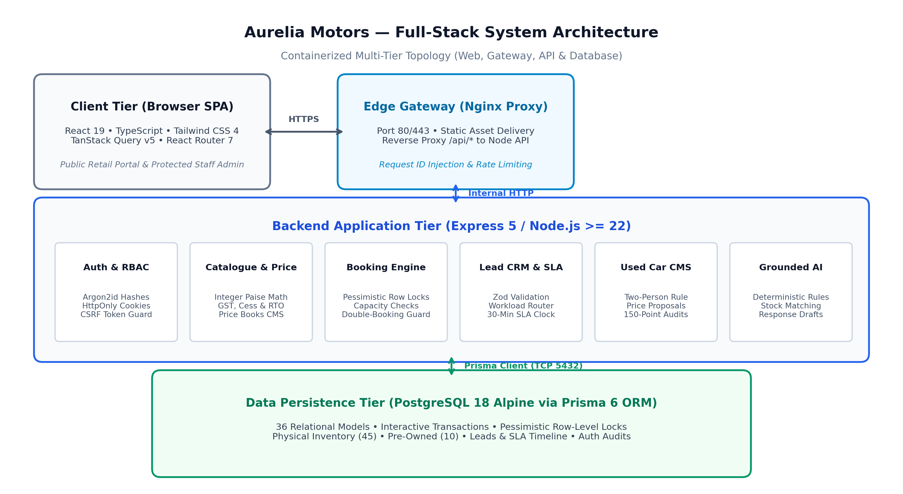
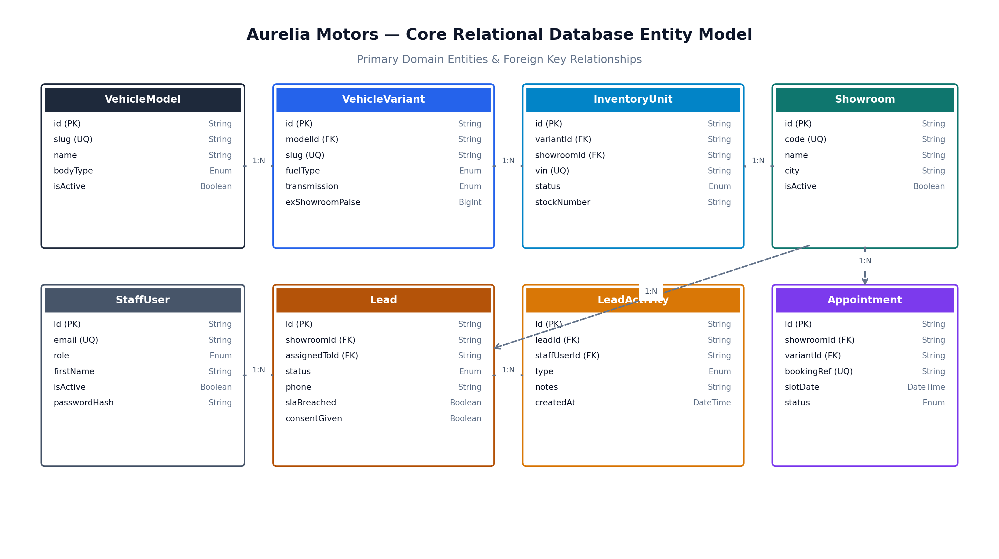
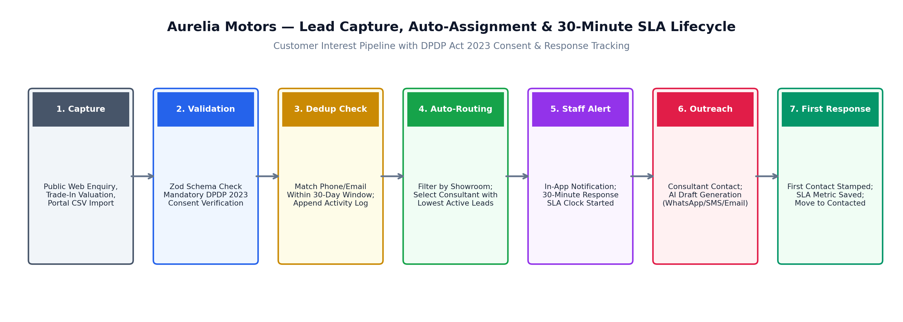

# Aurelia Motors — Technical Design Document

**Digital Automotive Dealership Platform & Multi-Facility Operations System**

- **Author:** Lochan T N
- **Project Nature:** Software Engineering Hiring Project
- **Document Version:** Version 1.0
- **Project Status:** Completed Hiring Assignment
- **Topology:** 3 Showrooms & 2 Authorized Workshops in Lucknow, Uttar Pradesh, India
- **Repository:** [https://github.com/lochan87/aurelia-motors](https://github.com/lochan87/aurelia-motors)
- **Automated Verification:** 127 Passing Automated Tests across 18 Test Suites (100% Pass Rate)
- **Technology Stack:** TypeScript Monorepo, React 19 SPA, Express 5 REST API, PostgreSQL 18 / 16+, Prisma 6 ORM

---

## Table of Contents

1. [Executive Summary](#1-executive-summary)
2. [Problem Statement and Scope](#2-problem-statement-and-scope)
3. [Technology Stack and Architecture Decisions](#3-technology-stack-and-architecture-decisions)
4. [System Architecture Diagram](#4-system-architecture-diagram)
5. [Database Design and Entity Relationships](#5-database-design-and-entity-relationships)
6. [Core Customer Workflows](#6-core-customer-workflows)
7. [Dealership Operations](#7-dealership-operations)
8. [AI-Assisted Features and Limitations](#8-ai-assisted-features-and-limitations)
9. [Authentication, Authorization and Data Privacy](#9-authentication-authorization-and-data-privacy)
10. [Testing and Verification](#10-testing-and-verification)
11. [Local Setup and Deployment](#11-local-setup-and-deployment)
12. [Known Limitations and Future Improvements](#12-known-limitations-and-future-improvements)
13. [Repository and Reviewer Access](#13-repository-and-reviewer-access)

---

## 1. Executive Summary

Aurelia Motors is an individual software engineering hiring project designed to model an authorized multi-facility passenger car franchise network in Lucknow, Uttar Pradesh, India. The application unifies customer-facing digital automotive retail with internal back-office dealership operations.

The physical franchise network modeled and seeded in the platform comprises three retail showrooms and two authorized workshops:

- **Showroom 1 (LKO-CENTRAL):** Central Lucknow Flagship, Ashok Marg, Hazratganj (sedan and crossover sales).
- **Showroom 2 (LKO-GOMTI):** Gomti Nagar Boutique Centre, Gomti Nagar Phase 2 (executive sedans and electric vehicles).
- **Showroom 3 (LKO-KANPUR):** Kanpur Road Facility, Kanpur Highway Corridor (SUVs and certified pre-owned units).
- **Workshop 1 (LKO-WS-TRANS):** Transport Nagar Maintenance Center (8 service bays, accident repairs, scheduled maintenance).
- **Workshop 2 (LKO-WS-ALAM):** Alambagh Express Service Clinic (8 service bays, fast-track maintenance, diagnostic servicing).

The platform bridges public customer retail (model discovery, multi-variant comparison, transparent on-road pricing with reducing-balance EMI calculators, capacity-safe test-drive bookings, workshop service scheduling, and certified pre-owned cars with 150-point inspection findings) with operational dealership back-office execution (role-based staff authentication, automated lowest-workload lead routing, 30-minute response-time SLA tracking, portal CSV batch ingestion, CMS inventory management, two-person used-car price governance, and grounded domain intelligence).

---

## 2. Problem Statement and Scope

Automotive retail across Tier-1 and Tier-2 Indian metropolitan markets has historically suffered from fragmented customer touchpoints, opaque pricing estimates omitting state taxes, frequent double-booking of demonstrator fleet vehicles, and unverified pre-owned claims. On the dealership side, sales consultants face scattered leads across third-party auto portals (CarDekho, CarWale), slow response times exceeding conversion windows, and lack of auditability for used-car price reductions.

### 2.1 Indian Regulatory and Fiscal Framework

- **Digital Personal Data Protection Act 2023 (DPDP Act):** Mandates explicit, auditable customer consent prior to collecting personal identifiers. The platform captures consent on all public forms, records immutable timestamps, and masks vehicle registration numbers (`UP32-XX-1234`) on public pre-owned listings.
- **Automotive Tax Structure:** On-road pricing incorporates Ex-showroom base prices, GST with applicable Compensation Cess, Uttar Pradesh State RTO registration fees (8% for petrol/EV, 10% for diesel), mandatory insurance estimates, logistics charges, and statutory Tax Collected at Source (TCS) of 1% on transactions exceeding ₹10,00,000.

### 2.2 Implemented Scope vs. Simulated Boundaries

- **Fully Implemented:** Public customer web SPA, authenticated staff CRM portal, PostgreSQL schema via Prisma 6 ORM, concurrency-safe test-drive and workshop booking engine, lead CRM with automated lowest-workload consultant routing, 30-minute response SLA tracking, CSV batch ingestion, two-person used car pricing governance, and deterministic grounded domain intelligence.
- **Simulated Boundaries:** Payment gateway checkout uses tokenized booking references rather than live payment gateway integration; customer communication (WhatsApp/SMS) generates grounded message drafts for staff review rather than transmitting live traffic over commercial telecom aggregator APIs.

---

## 3. Technology Stack and Architecture Decisions

The platform is structured as an npm workspaces monorepo:

- **Frontend SPA:** React 19, TypeScript, Vite, Tailwind CSS 4, React Router 7, TanStack Query v5.
- **Backend REST API:** Express 5, Node.js >= 22.0.0 (LTS 22/24, `node:22-alpine` in Dockerfiles), Zod runtime validation.
- **Data Persistence:** PostgreSQL 18 Alpine in Docker Compose (compatible with PostgreSQL 16+), Prisma 6.19 ORM.
- **Security & Auth:** Argon2id password hashing, signed HttpOnly SameSite=Lax session cookies, CSRF protection tokens, location-scoped RBAC middleware.

### Key Architectural Decisions

- **Integer Paise Currency Standard:** All monetary values are strictly represented as 64-bit BigInt integer paise (1 INR = 100 paise) to prevent floating-point precision loss.
- **Deterministic Grounded Domain Engine:** Operates via rule-based heuristics grounded in live PostgreSQL data, delivering fast local responses without generative confabulation, API billing costs, or external network dependencies.

---

## 4. System Architecture Diagram



### Request Lifecycle

1. **Ingress & Edge Proxy Tier:** Nginx reverse proxy on port 80/443 serves React 19 static assets, injects X-Request-ID headers, enforces rate limits, and proxies `/api/*` requests to Express.
2. **Application Middleware:** Express 5 parses JSON and cookies, enforces CORS, logs request traces via Pino, and executes CSRF middleware on mutating endpoints.
3. **Zod Validation:** Route controllers validate incoming payloads using isomorphic Zod schemas shared between client and server.
4. **Domain Services & Concurrency Controls:** Booking operations execute inside interactive Prisma transactions with pessimistic row-level locking (`SELECT ... FOR UPDATE`) to serialize concurrent slot requests.
5. **Persistence Tier:** Prisma Client executes parameterized SQL against PostgreSQL over dedicated connection pools.

---

## 5. Database Design and Entity Relationships



### Core Relational Models

- **Showroom & Workshop:** Facility locations across Lucknow with operating hours and geographic coordinates.
- **VehicleModel & VehicleVariant:** 6 passenger car models, 15 powertrain trims, detailed technical specifications.
- **NewVehicleInventory:** 45 physical showroom vehicles tracking VIN, stock number, and lifecycle status (`AVAILABLE`, `RESERVED`, `SOLD`).
- **UsedVehicle & UsedVehicleInspection:** 10 certified pre-owned units with 150-point inspection findings and masked registration plates (`UP32-XX-1234`).
- **PriceBook & PriceComponent:** Versioned pricing books with configurable component breakdowns (fixed paise or basis points).
- **StaffUser & StaffLocationAssignment:** Staff credentials, Argon2id hashes, and RBAC operational roles.
- **Lead & LeadActivity:** Inbound customer enquiries with 30-minute SLA countdown timers and consultation activity timelines.
- **TestDriveAppointment & ServiceAppointment:** Capacity-controlled demonstrator vehicle and workshop service bay bookings.
- **AuthenticationAuditEvent:** Immutable chronological audit log of staff authentication events.

---

## 6. Core Customer Workflows

### 6.1 Vehicle Discovery and Comparison

Prospective buyers browse 6 passenger vehicle models and 15 variants, filtering by body type, fuel type, transmission, and budget ranges, with side-by-side specification comparisons.

### 6.2 On-Road Price Transparency and EMI Calculations

Itemized on-road pricing formula:
$$	ext{On-Road Price} = 	ext{Ex-Showroom} + 	ext{RTO} + 	ext{Insurance} + 	ext{TCS} + 	ext{Logistics} + 	ext{Accessories}$$

- **RTO:** Configurable rate (sample: 8% for Petrol/EV/Hybrid; 10% for Diesel in Uttar Pradesh).
- **TCS:** Statutory 1% on transactions exceeding ₹10,00,000 (100,000,000 paise).
- **Reducing-Balance EMI Formula:**
  $$E = P \cdot r \cdot rac{(1+r)^n}{(1+r)^n - 1}$$

### 6.3 Capacity-Safe Test-Drive Reservations

Wraps demonstrator slot reservations in interactive Prisma transactions with pessimistic row-level locks (`SELECT id FROM demo_vehicles WHERE id = ANY(...) FOR UPDATE`) to serialize concurrent requests. Enforces idempotency via unique `idempotencyKey` constraints. Returns a booking reference (e.g., `TD-2026-8742`) and confirmation token.

### 6.4 Workshop Service Appointment Scheduling

Enforces daily workshop bay capacity limits (maximum 8 service appointments per workshop per calendar day) using pessimistic row locks on the workshop row (`SELECT id FROM workshops WHERE id = ... FOR UPDATE`) inside an interactive transaction.

### 6.5 Algorithmic Pre-Owned Trade-In Valuation

Multi-variable algorithmic valuation model considering original invoice price, annual straight-line depreciation (12%/year), mileage penalties (₹1.50/km above 10,000 km/yr), and condition multipliers (0.90 Fair, 1.00 Good, 1.08 Excellent).

---

## 7. Dealership Operations



### 7.1 Inbound Lead Capture and Automated Routing

Captures customer enquiries across web forms and portal CSV imports. Enforces DPDP Act 2023 consent, detects duplicates within a 30-day window, and automatically routes leads to the sales consultant with the lowest count of active leads (`[NEW, ASSIGNED, CONTACTED, QUALIFIED, NEGOTIATING]`), breaking ties by least recently assigned timestamp.

### 7.2 Lead CRM Pipeline and 30-Minute SLA Tracking

Staff dashboard displays active leads with real-time countdown timers against a 30-minute first-response SLA. Logging a customer interaction records response timestamps; exceeding 30 minutes permanently tags the lead as SLA breached.

### 7.3 External Portal CSV Batch Ingestion

Two-stage ingestion pipeline: Stage 1 parses and validates CSV rows (POST `/api/staff/leads/import/preview`), detecting duplicates; Stage 2 atomically batch-inserts leads and assigns consultants (POST `/api/staff/leads/import`).

### 7.4 Inventory CMS and Price Book Governance

Administrators manage models, variants, physical showroom inventory allocations, and promotional banners. Price books enforce non-overlapping date intervals.

### 7.5 Used-Car Pricing Proposals and Separation of Duties

Used Car Specialists submit price adjustment proposals in integer paise with written justification. Administrators review, approve, or reject proposals. Separation of duties is enforced at the application and authorization layer: the approving staff member must hold the ADMIN role and cannot approve their own proposal (`proposal.proposedByStaffId === reviewer.id`).

---

## 8. AI-Assisted Features and Limitations

The Aurelia Grounded Domain Engine provides deterministic, rules-based staff assistance grounded in live PostgreSQL data:

1. **Lead Intent & Urgency Scoring (POST `/api/staff/ai/:leadId/summary`):** Extracts powertrain preferences, budget brackets, and computes urgency scores (1-5).
2. **Multi-Channel Response Drafts (POST `/api/staff/ai/:leadId/response-draft`):** Generates personalized WhatsApp, SMS, and Email drafts for consultant review and manual dispatch.
3. **Inventory Recommendations (POST `/api/staff/ai/:leadId/recommendations`):** Matches customer preferences against available showroom and pre-owned inventory (+/- 15% budget), strictly filtered by `status: 'AVAILABLE'`.

### Boundaries & Guardrails

- Eliminates generative confabulation because outputs are generated deterministically from database queries and structured templates.
- No automated external transmission: generates drafts for human-in-the-loop staff review.
- Executes in-process on the local Node.js runtime without external API network overhead.

---

## 9. Authentication, Authorization and Data Privacy

- **Credentials:** Argon2id hashing with secure random salts, rate-limited login endpoints.
- **Sessions:** Signed, HttpOnly, SameSite=Lax session cookies with CSRF tokens.
- **RBAC Roles:** `ADMIN` (all facilities, full CMS/admin), `SALES_CONSULTANT` (showroom-scoped leads & test-drives), `USED_CAR_STAFF` (trade-ins & price proposals), `SERVICE_ADVISOR` (workshop bay queues).
- **Data Privacy:** Explicit DPDP Act 2023 consent recording, plate masking on pre-owned listings (`UP32-XX-1234`), immutable authentication audit logging (`AuthenticationAuditEvent`).

---

## 10. Testing and Verification

Multi-tier automated test suite comprising **127 passing automated tests across 18 test suites**:

- **Domain Unit Tests (@aurelia/shared — 3 suites, 14 tests):** Shared finance formulas, on-road pricing math, currency formatting.
- **API Integration Tests (@aurelia/api — 14 suites, 99 tests):** Express routes, Zod validation, Prisma queries, Argon2id auth, RBAC access control.
- **API Journey Integration Tests (@aurelia/api — 1 suite, 14 tests in `e2e-journeys.test.ts`):** Complete customer and staff workflows:
  - Customer Journey 1: Model Discovery -> On-Road Pricing -> Enquiry -> Consultant Assignment.
  - Customer Journey 2: Pre-Owned Browsing -> 150-Point Report -> Trade-In Valuation.
  - Customer Journey 3: Test-Drive Booking -> Double-Booking Rejection -> Cancellation.
  - Customer Journey 4: Workshop Service Booking -> Bay Capacity Enforcement.
  - Staff Operations: CRM Response Tracking -> CSV Batch Ingestion -> Grounded AI Operations.
  - Security & Isolation: Cross-Showroom Data Isolation -> CSRF Defense -> Admin Barriers.
- **Note on Test Scope:** `e2e-journeys.test.ts` executes multi-step integration journey assertions via Supertest against the running Express HTTP pipeline and PostgreSQL database. The repository does not include browser-driven UI automation (such as Playwright or Cypress); all automated test assertions operate at the shared domain logic and API integration levels.

---

## 11. Local Setup and Deployment

### Prerequisites

- Node.js >= 22.0.0, npm >= 10.0.0
- PostgreSQL 16+ or Docker Desktop running `postgres:18-alpine`

### Local Development

```bash
# Clone and install
git clone https://github.com/lochan87/aurelia-motors.git
cd aurelia-motors
npm install

# Initialize database
npm run build:shared
npm run db:migrate --workspace @aurelia/api
npm run db:seed --workspace @aurelia/api

# Start dev servers
npm run dev
```

### Docker Compose Deployment

```bash
docker compose up -d --build
curl http://localhost/api/health
```

### Seed Demonstration Accounts

- **Admin:** `admin@aureliamotors.com` (All Facilities — CMS, price approvals, staff administration)
- **Sales Consultant:** `sales.gomti@aureliamotors.com` (Gomti Nagar Showroom — Lead CRM, SLA tracking, test-drives)
- **Used Car Specialist:** `usedcars@aureliamotors.com` (Central Showroom — 150-point inspections, price adjustment proposals)
- **Service Advisor:** `service.transport@aureliamotors.com` (Transport Nagar Workshop — Bay capacity queue, service check-ins)

_Note on Demonstration Credentials:_ In accordance with security best practices, plaintext passwords are not published in this technical specification. Demonstration staff accounts are provisioned with environment-configurable credentials documented in `deployment.md` (default: `AURELIA_DEMO_PASSWORD`). No production credentials exist.

---

## 12. Known Limitations and Future Improvements

- **Simulated Gateways:** Payment deposits generate cryptographic references rather than processing live payment gateway transactions.
- **Simulated Telecom:** WhatsApp/SMS drafts are formatted for human review rather than transmitted over live aggregator APIs.
- **Concurrency Scale:** PostgreSQL interactive transactions and row-level locks provide strong consistency; multi-node distributed scale would benefit from Redis Redlock.
- **Future Roadmap:** Server-Sent Events (SSE) for instant CRM notifications, external DMS sync protocols, and read replicas for multi-region scale.

---

## 13. Repository and Reviewer Access

- **Repository:** [https://github.com/lochan87/aurelia-motors](https://github.com/lochan87/aurelia-motors)
- **Primary Branch:** `main`
- **Author:** Lochan T N
- **License:** No license file; submitted for hiring evaluation
- **Verification Commands:**
  - Test Suite: `npm test`
  - Linting: `npm run lint`
  - Typecheck: `npm run typecheck`
